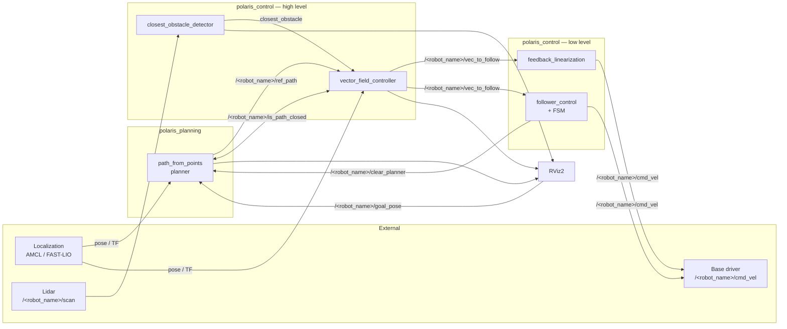

# Polaris Control — Navigation & Control Stack

This document describes how to run the **polaris_control** navigation stack, how its nodes integrate with **polaris_planning** and the rest of the robot software, and what the main source files do.

For the repository-level integration overview, see [polaris_navigation README.md](../../README.md). For planner-specific details, see [polaris_planning/docs/PATH_PLANNING.md](../../polaris_planning/docs/PATH_PLANNING.md).

The stack is split into two layers:

1. **High-level navigation** — path planning + vector-field control (optionally with obstacle avoidance).
2. **Low-level execution** — converts a desired velocity vector into differential-drive `cmd_vel`, with or without an orientation FSM.

---

## Quick reference — launch files

| Launch file | Role | Obstacle avoidance | Orientation FSM |
|---|---|---|---|
| [`navigation.launch.py`](../launch/navigation.launch.py) | Planner + vector-field controller | **No** (detector not started) | N/A |
| [`safe_nav_stack.launch.py`](../launch/safe_nav_stack.launch.py) | Legacy root-namespace Scout stack; not namespace-contract compliant | **Yes** (`closest_obstacle_detector`) | N/A |
| [`feedback_linearization.launch.py`](../launch/feedback_linearization.launch.py) | Low-level follower only | N/A | **No** |
| [`follower_control.launch.py`](../launch/follower_control.launch.py) | Low-level follower only | N/A | **Yes** |

Other launches (legacy / demo):

| Launch file | Notes |
|---|---|
| [`demo.launch.py`](../launch/demo.launch.py) | Older demo stack; uses `path_from_equation` and Scout-specific static TFs |

## Namespaced robot stacks

`navigation.launch.py` and `follower_control.launch.py` accept the same
multi-robot arguments:

- `robot_name` is required and places every launched node and relative ROS
  interface under that exact robot identity.
- `namespace_tf:=true` remaps `/tf` and `/tf_static` to the robot's namespaced
  TF topics. Its default remains `false` for legacy integrations.
- `prefix_tf_frames:=true` prefixes local frame arguments such as `map` and
  `body` with `robot_name`. Frames already below that namespace are left
  unchanged, so a prefix is never applied twice. Its default remains `true`.
- `use_sim_time` selects the simulation clock for all nodes in the launch.

The two compatibility flags are independent. Only
`namespace_tf:=true prefix_tf_frames:=true` satisfies the multi-robot namespace
contract; other combinations remain available for legacy robot integrations.

Prefer local frame values such as `tf_reference_frame:=map` and
`tf_robot_pose:=body` when prefixing is enabled. Fully qualified values such as
`scout_1/map` remain accepted for compatibility. TF frame IDs must not begin
with `/`.

Launch both halves of a simulated Pioneer stack as follows:

```bash
ros2 launch polaris_control navigation.launch.py \
  robot_name:=pioneer_1 namespace_tf:=true prefix_tf_frames:=true use_sim_time:=true
ros2 launch polaris_control follower_control.launch.py \
  robot_name:=pioneer_1 params_file:=pioneer_params.yaml \
  namespace_tf:=true prefix_tf_frames:=true use_sim_time:=true
```

The resulting nodes are `/pioneer_1/controller`, `/pioneer_1/planner`, and
`/pioneer_1/follower_control`. Robot-local topics and services are relative in
the parameter YAML, so names such as `tf`, `goal_pose`, `ref_path`,
`vec_to_follow`, and `cmd_vel` resolve below `/pioneer_1`. For a legacy TF
graph, pass either compatibility flag as `false` explicitly; `robot_name`
remains required.

---

## How to run (dummy workflow)

These commands assume a ROS 2 workspace with **polaris_control** and **polaris_planning** built, and the robot stack (localization, lidar, base driver) running separately.

### 1. Build and source

```bash
cd ~/polaris_ws
colcon build --symlink-install --packages-select polaris_control polaris_planning
source install/setup.bash
```

### 2. Start localization and sensors (external — not in this package)

Run your robot bringup as usual. The control stack expects at least:

- Robot pose in **`map`** (e.g. relative `amcl_pose` as `PoseWithCovarianceStamped`, or TF `map` → `body`)
- Lidar publishing relative **`scan`** (only required for `safe_nav_stack.launch.py`)
- Base driver subscribed to relative **`cmd_vel`**

```bash
# Example placeholders — replace with your robot launch files
ros2 launch <your_robot_pkg> localization.launch.py
ros2 launch <your_robot_pkg> lidar.launch.py
ros2 launch <your_robot_pkg> base_driver.launch.py
```

### 3. Start high-level navigation

**Without obstacle avoidance:**

```bash
ros2 launch polaris_control navigation.launch.py robot_name:=pioneer_1 \
  namespace_tf:=true prefix_tf_frames:=true
```

**With obstacle avoidance:**

```bash
ros2 launch polaris_control safe_nav_stack.launch.py
```

### 4. Start low-level control (second terminal)

**Without orientation FSM** (legacy root-namespace launcher):

```bash
ros2 launch polaris_control feedback_linearization.launch.py
```

**With orientation FSM** (supports stop, path clear, and yaw alignment at inspection points):

```bash
ros2 launch polaris_control follower_control.launch.py \
  robot_name:=pioneer_1 params_file:=pioneer_params.yaml \
  namespace_tf:=true prefix_tf_frames:=true
```

### 5. Send goals in RViz

With a robot-scoped RViz instance open (provided by robot bringup):

1. Use **Publish Point** / **2D Goal Pose** on `/<robot_name>/goal_pose`.
2. Call `/<robot_name>/start_planner` to publish the interpolated path.
3. Optional: use the corresponding namespaced `close_path`, `clear_planner`, and `remove_last_point` services.

```bash
# Dummy service calls
ros2 service call /pioneer_1/start_planner std_srvs/srv/Trigger {}
ros2 service call /pioneer_1/clear_planner std_srvs/srv/Trigger {}
```

### 6. FSM-specific commands (follower_control only)

When using `follower_control.launch.py`:

```bash
# Stop motion and clear the path (from CONTROL_POSITION)
ros2 topic pub --once /pioneer_1/stop_robot std_msgs/msg/Bool "{data: true}"

# Select yaw alignment (clears the path only when entering ALIGN_YAW)
ros2 topic pub --once --qos-reliability reliable --qos-durability transient_local \
  /pioneer_1/stop_control std_msgs/msg/String "{data: ALIGN_YAW}"

# Select path tracking. Repeating either state command is harmless.
ros2 topic pub --once --qos-reliability reliable --qos-durability transient_local \
  /pioneer_1/stop_control std_msgs/msg/String "{data: CONTROL_POSITION}"

# Target point to face while in ALIGN_YAW
ros2 topic pub --once --qos-reliability reliable --qos-durability transient_local \
  /pioneer_1/inspection_pose geometry_msgs/msg/PoseStamped \
  "{header: {frame_id: 'pioneer_1/map'}, pose: {position: {x: 1.0, y: 2.0, z: 0.0}}}"
```

---

## Architecture — how components integrate



### Data flow summary

| Stage | Input | Output | Node |
|---|---|---|---|
| Planning | Clicked points (`/<robot_name>/goal_pose`), robot pose | Interpolated path (`/<robot_name>/ref_path`) | `path_from_points` |
| Vector field | Path, pose, optional closest obstacle | Desired velocity vector (`/<robot_name>/vec_to_follow`) | `vector_field_controller` |
| Perception | `sensor_msgs/LaserScan` | Closest obstacle point (`closest_obstacle`) | `closest_obstacle_detector` |
| Execution | `/<robot_name>/vec_to_follow`, robot orientation | `geometry_msgs/Twist` on `/<robot_name>/cmd_vel` | `feedback_linearization` or `follower_control` |

Contract-compliant launches resolve local configured frames such as `map` and
`body` to `<robot_name>/map` and `<robot_name>/body`.

### navigation.launch.py vs safe_nav_stack.launch.py

`navigation.launch.py` is the robot-aware integration entry point. It starts
only `vector_field_controller` and `path_from_points`; robot bringup owns RViz,
sensor drivers, obstacle detection, and every hardware TF edge.

`safe_nav_stack.launch.py` is retained as a legacy root-namespace Scout
launcher. It also starts RViz, `closest_obstacle_detector`, and Scout-specific
static transforms, so it is not namespace-contract compliant.

| | `navigation.launch.py` | `safe_nav_stack.launch.py` |
|---|---|---|
| `closest_obstacle_detector` | Not launched | Launched |
| Params file | Selectable; default `pioneer_params.yaml` | `scout_params.yaml` |
| Effective avoidance | Disabled (no obstacle messages received) | Enabled when lidar + TF are available |

Even though both param files set `flag_follow_obstacle: true`, the controller only blends avoidance fields when it receives obstacle data on `closest_obstacle`. Without the detector node, behavior reduces to pure path following.

To disable avoidance explicitly while running the safe stack, set `flag_follow_obstacle: false` under the `controller` section in the params YAML.

### feedback_linearization vs follower_control

Both nodes subscribe to relative **`vec_to_follow`**
(`geometry_msgs/Vector3`) and publish relative **`cmd_vel`**
(`geometry_msgs/Twist`). Under `/<robot_name>`, they resolve to robot-scoped
interfaces. Both use the same feedback-linearization law: rotate the global
desired velocity into the robot frame and map it to linear `v` and angular
`ω` using a control-point distance `distancia_ponto_controle`.

| | `feedback_linearization.py` | `follower_control.py` |
|---|---|---|
| FSM | None — always active when vector is present | `STOPPED` → `CONTROL_POSITION` → `ALIGN_YAW` |
| Stop / clear path | No | Relative `stop_robot`, `stop_control` |
| Yaw alignment | No | Relative `inspection_pose` (param: `orient_point_topic`) |
| Planner interaction | No | Calls relative `clear_planner` on stop transitions |

Use **feedback_linearization** for simple go-to-path behavior. Use **follower_control** when the mission requires pausing, clearing the path, or rotating in place to face inspection targets.

---

## Main files

### Launch files

| File | Description |
|---|---|
| [`launch/navigation.launch.py`](../launch/navigation.launch.py) | Robot-aware planner + vector-field controller; requires `robot_name`. |
| [`launch/safe_nav_stack.launch.py`](../launch/safe_nav_stack.launch.py) | Legacy root-namespace Scout stack with RViz, obstacle detector, and static TFs. |
| [`launch/feedback_linearization.launch.py`](../launch/feedback_linearization.launch.py) | Starts only the feedback-linearization follower node. |
| [`launch/follower_control.launch.py`](../launch/follower_control.launch.py) | Starts only the FSM-based follower node. |
| [`launch/demo.launch.py`](../launch/demo.launch.py) | Legacy demo with equation-based planner and Scout/FAST-LIO TFs. |

### C++ nodes (built via `CMakeLists.txt`)

| File | Executable | Role |
|---|---|---|
| [`src/vector_field_control.cpp`](../src/vector_field_control.cpp) | `vector_field_controller` | Core controller. Tracks `ref_path` with a vector field; optionally blends an obstacle-circumnavigation field ([Nunes et al., 2022](https://ieeexplore.ieee.org/document/9992435)). Publishes relative `vec_to_follow`, visualizes command and path in RViz. Runs at 20 Hz. |
| [`src/closest_obstacle_detector.cpp`](../src/closest_obstacle_detector.cpp) | `closest_obstacle_detector` | Subscribes to `LaserScan`, clusters returns with DBSCAN, transforms to `map`, publishes the closest cluster centroid as `geometry_msgs/Point`. |

### Python nodes

| File | Role |
|---|---|
| [`src/feedback_linearization.py`](../src/feedback_linearization.py) | Converts relative `vec_to_follow` → `cmd_vel` without state machine. |
| [`src/follower_control.py`](../src/follower_control.py) | Same conversion plus FSM for stop, path clear, yaw alignment and base hold. |
| [`src/picture_taker.py`](../src/picture_taker.py) | Takes the fleet's photos once the base is still and the gimbal on target; rules in `src/picture_rules.py`. |
| [`scripts/robot_simulator.py`](../scripts/robot_simulator.py) | Standalone simulator (TF + markers + fake obstacle) for offline testing. Not started by the main nav launches (commented out). |

### Configuration

| File | Used by | Purpose |
|---|---|---|
| [`config/pioneer_params.yaml`](../config/pioneer_params.yaml) | `navigation.launch.py`, `feedback_linearization.launch.py`, `follower_control.launch.py` | Params for `controller`, `feedback_linearization`, and `follower_control` nodes (Pioneer robot / generic setup). |
| [`config/scout_params.yaml`](../config/scout_params.yaml) | `safe_nav_stack.launch.py` | Same structure as pioneer params; used with Scout platform. |
| [`config/closest_obstacle_detector_params.yaml`](../config/closest_obstacle_detector_params.yaml) | `safe_nav_stack.launch.py` | Lidar topic, DBSCAN settings, frames (`livox_frame` → `map`). |
| [`config/demo_rviz.rviz`](../config/demo_rviz.rviz) | Nav launches | Preconfigured RViz layout (path, markers, TF). |
| [`config/follow_params.yaml`](../config/follow_params.yaml) | Legacy wall-following (TODO) | Parameters for unimplemented `follow_wall` node. |
| [`config/control_params.yaml`](../config/control_params.yaml) | Legacy | Old espeleo_control parameter format; superseded by `pioneer_params.yaml` / `scout_params.yaml`. |

Param files use ROS 2 node namespaces (`controller:`, `feedback_linearization:`, `follower_control:`) that must match the node `name=` in each launch file.

### Build / package metadata

| File | Role |
|---|---|
| [`CMakeLists.txt`](../CMakeLists.txt) | Builds C++ executables; installs launches, config, URDF, Python scripts. |
| [`package.xml`](../package.xml) | ROS 2 package manifest and dependencies. |
| [`setup.py`](../setup.py) | Legacy setuptools stub (main build is ament_cmake). |

### TODO / reference implementations

| Path | Status |
|---|---|
| [`src/TODO/`](../src/TODO/) | Reference code for future nodes: `follow_wall`, `follow_corridor`, alternate obstacle detector, C++ feedback linearization. Not built or installed. |

---

## Key topics and services

### Topics

| Topic | Type | Publisher | Subscriber(s) |
|---|---|---|---|
| `/<robot_name>/goal_pose` | `PoseStamped` | RViz | `path_from_points` |
| `/<robot_name>/ref_path` | `Path` | `path_from_points` | `vector_field_controller` |
| `/<robot_name>/vec_to_follow` | `Vector3` | `vector_field_controller` | `feedback_linearization`, `follower_control` |
| `/<robot_name>/cmd_vel` | `Twist` | follower nodes | Robot base driver |
| `/<robot_name>/amcl_pose` | `PoseWithCovarianceStamped` | Localization | Controller + followers (configurable) |
| `/<robot_name>/closest_obstacle` | `Point` | `closest_obstacle_detector` | `vector_field_controller` |
| `/<robot_name>/scan` | `LaserScan` | Lidar driver | `closest_obstacle_detector` |
| `/<robot_name>/visualization_command` | `Marker` | `vector_field_controller` | RViz |
| `/<robot_name>/visualization_path` | `MarkerArray` | `vector_field_controller` | RViz |
| `/<robot_name>/obstacle_clusters` | `MarkerArray` | `closest_obstacle_detector` | RViz |
| `/<robot_name>/inspection_pose` | `PoseStamped` | External / mission node | `follower_control` |
| `/<robot_name>/stop_robot` | `Bool` | External | `follower_control` |
| `/<robot_name>/stop_control` | `String` | External | `follower_control` |

`/<robot_name>/stop_control` is a RELIABLE + TRANSIENT_LOCAL desired-state command, not a
toggle event. The only accepted values are `ALIGN_YAW`, `CONTROL_POSITION` and
`HOLD`; `HOLD` holds the base still (zero `cmd_vel`, `vec_to_follow`
ignored) until `CONTROL_POSITION`. The fleet manager sends it while a camera
gimbal moves and while `picture_taker` takes a photo (it was named `PAN_TILT`
before photos used it).
Publishers must use the same message type and durability. This makes duplicate
delivery, late-joiner replay, and rapid command replacement idempotent.
The follower imports `FollowerControlState` from `src/FollowerControlState.py`,
installed next to it and kept equal to the one in `petro_rmf_utils`; `STOPPED`
remains an internal FSM state selected through `/<robot_name>/stop_robot`, not a
valid `/<robot_name>/stop_control` command.

### Photos for the fleet (`picture_taker`)

`follower_control.launch.py` also starts `src/picture_taker.py` when the params
file has a `picture_taker` section (`scout_params.yaml`, `pioneer_params.yaml`).
The fleet manager asks for a photo on `/<robot_name>/take_picture_request` and
reads the answer on `/<robot_name>/take_picture_result`, both `std_msgs/String`
JSON, so the fleet depends on no Polaris message type:

```
request  {"request_id", "camera", "expected_joints": {"pan", "tilt"}?, "timeout_sec"?}
result   {"request_id", "state": "accepted" | "succeeded" | "failed", "camera",
          "reason" (failed), "stamp", "joints", "pose",
          "image": {"format": "jpeg", "width", "height", "data_base64"} (succeeded)}
```

`cameras` lists the names the fleet uses; each one is `fixed` or `pan_tilt` and
names the `hk_camera_interfaces/srv/TakePhoto` service that takes its photo. The
node answers `accepted`, then takes the photo once the robot is ready:

- the base stayed within `still_linear_m` / `still_angular_rad` for
  `still_window_sec` (pose from `tf_inertial_link <- tf_robot_pose`, the frames
  the follower uses);
- for a `pan_tilt` camera with `expected_joints`: fresh `joint_state_topic`
  feedback, both joints within `tolerance_rad` (pan modulo 2π) for `settle_sec`;
- the service returns a frame captured after that moment (`TakePhoto.stamp`).

What still blocks the photo at `ready_timeout_sec` (or the request's
`timeout_sec`) is sent back as `failed` with the reason; the fleet then fails the
task. `max_width` (0 by default, full resolution) scales wider photos down.
The section describes the simulated robot; its `hardware` mapping overrides those
values when `use_sim_time` is false (the Hikvision driver's service and joint
states instead of the simulated ones). The rules are in `src/picture_rules.py`
(no ROS), tested by `test/test_picture_rules.py`.

### Services (polaris_planning)

| Service | Type | Purpose |
|---|---|---|
| `/<robot_name>/start_planner` | `Trigger` | Begin publishing the interpolated path |
| `/<robot_name>/clear_planner` | `Trigger` | Clear waypoints and path |
| `/<robot_name>/close_path` | `Trigger` | Close the path loop |
| `/<robot_name>/is_path_closed` | `Trigger` | Queried by controller to know if goal-stop logic applies |
| `/<robot_name>/remove_last_point` | `Trigger` | Remove the last added waypoint |

---

## TF frames

`navigation.launch.py` and `follower_control.launch.py` do not publish robot
transforms. With `prefix_tf_frames:=true`, they resolve configured local frame
IDs from YAML beneath `<robot_name>/`; the robot bringup remains the sole owner
of the corresponding TF edges. The legacy `safe_nav_stack.launch.py` still
publishes its historical `map` → `odom` and `body` → `livox_frame` transforms.

---

## Typical deployment combinations

| Scenario | High-level launch | Low-level launch |
|---|---|---|
| Namespaced robot integration | `navigation.launch.py` with both compatibility flags `true` | `follower_control.launch.py` with both flags `true` |
| Legacy field robot with lidar | `safe_nav_stack.launch.py` | `feedback_linearization.launch.py` |
| Legacy simulation / bench test | `demo.launch.py` | `feedback_linearization.launch.py` |

---

## Related packages

- **[polaris_planning](../../polaris_planning/)** — waypoint-based path planner (`path_from_points`). Required by both nav launches.
- **Robot bringup** — localization, lidar, and base driver are outside this package and must be running before starting control.

---

## References

- Vector-field obstacle avoidance: Nunes, A. H. D., et al. (2022). *Vector field for curve tracking with obstacle avoidance*. IEEE. [DOI link](https://ieeexplore.ieee.org/document/9992435)
- Package README: [`README.md`](../README.md)
